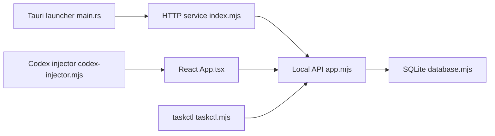

# chuspeeism/dashi-taskboard

> Tableau de tâches local intégrable dans l'application Codex, avec CLI et Skill dédiés, pour utilisateurs de Codex.

## Le problème
Suivre ce que fait un agent Codex sur plusieurs tâches demande un tableau de bord séparé et synchronisé à la main.

## Ce que ça fait vraiment
Service Node avec base SQLite et API HTTP, interface React (Kanban, Gantt, liste), CLI `taskctl` et Skill `manage-taskboard` qui apprend à l'agent le cycle todo → in_progress → in_review. Un injecteur CDP insère l'entrée dans la barre latérale de Codex sans modifier l'application. Un lanceur Tauri empaquette le tout (macOS, Windows, Linux). Un mode partagé via Cloudflare Worker, D1 et R2 existe.

## Comment c'est branché


## Essayer
```bash
npm install
npm run build
npm start
npm run taskctl -- project create --id my-project --name "My project" --workspace-path /absolute/path/to/repository
CODEX_TASKBOARD_HOST=127.0.0.1 npm run codex
```

## Coût et pièges
Gratuit. Node 22.5+ ; Rust 1.88+ pour les builds d'application. Par défaut le service écoute sur `0.0.0.0` sans authentification : mets `CODEX_TASKBOARD_HOST=127.0.0.1`. Le CDP n'est pas authentifié : lance le lanceur seulement avec du code de confiance.

## Ce que ce n'est pas
Pas un outil indépendant : il dépend de l'application officielle Codex et de ses marqueurs internes, qui peuvent changer. Les builds Windows ne sont pas signés.

## Alternatives
Aucune alternative nommée dans le README.

## Pour toi
À surveiller : utile si tu travailles dans Codex, mais couplé à une application tierce non stable ; sinon un autre gestionnaire de tâches suffit.

