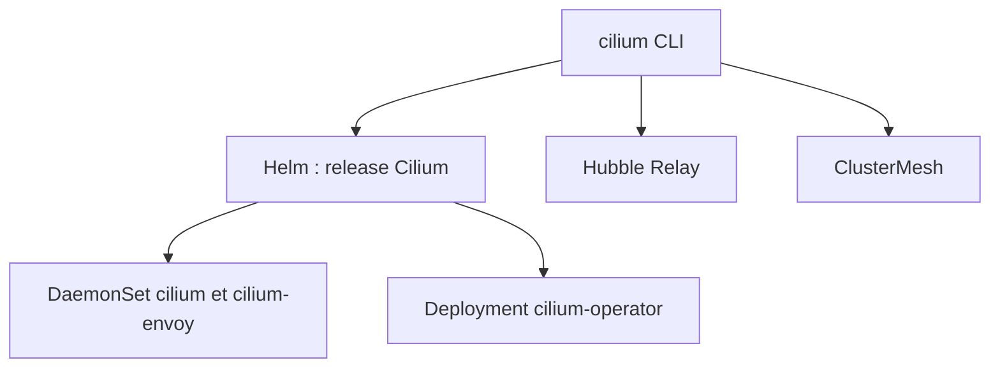

# cilium/cilium-cli

> CLI to install, inspect and test Cilium on a Kubernetes cluster, for cluster operators.

## The problem
Installing Cilium, or enabling Hubble, ClusterMesh or encryption by hand, means chaining Helm charts and checks.

## What it actually does
The commands `cilium install`, `upgrade`, `status`, `hubble enable`, `clustermesh enable/connect` and `connectivity test` deploy and validate Cilium. They detect the cluster type (minikube, kind, GKE) and rely on Helm. `connectivity perf` measures pod-to-pod latency and throughput.

## How it is wired


## Trying it
```bash
make install
cilium install
cilium status
cilium connectivity test --single-node
cilium hubble enable
```

## Cost and gotchas
Free, but you need a Kubernetes cluster with kubectl access. The README's example outputs date from Cilium 1.9; version v0.20.2 targets Cilium 1.17 and later.

## What it is not
It is not Cilium itself: only its installation and diagnostic tool. It does not manage the underlying cluster.

## Alternatives
No alternative named in the README (Helm is cited as the layer it uses).

## For you
Keep an eye on it: only useful if you administer an MLOps Kubernetes cluster with Cilium as the network.
