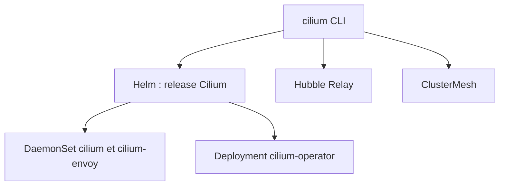

# cilium/cilium-cli

> CLI pour installer, inspecter et tester Cilium sur un cluster Kubernetes, pour opérateurs de clusters.

## Le problème
Installer Cilium, activer Hubble, ClusterMesh ou le chiffrement à la main revient à enchaîner charts Helm et vérifications.

## Ce que ça fait vraiment
Les commandes `cilium install`, `upgrade`, `status`, `hubble enable`, `clustermesh enable/connect` et `connectivity test` déploient et valident Cilium. Elles détectent le type de cluster (minikube, kind, GKE) et s'appuient sur Helm. `connectivity perf` mesure latence et débit pod à pod.

## Comment c'est branché


## Essayer
```bash
make install
cilium install
cilium status
cilium connectivity test --single-node
cilium hubble enable
```

## Coût et pièges
Gratuit, mais il faut un cluster Kubernetes avec accès kubectl. Les sorties d'exemple du README datent de Cilium 1.9 ; la version v0.20.2 cible Cilium 1.17 et plus.

## Ce que ce n'est pas
Ce n'est pas Cilium lui-même : seulement son outil d'installation et de diagnostic. Il ne gère pas le cluster sous-jacent.

## Alternatives
Aucune alternative nommée dans le README (Helm est cité comme couche utilisée).

## Pour toi
Surveiller : utile seulement si tu administres un cluster Kubernetes MLOps avec Cilium comme réseau.

