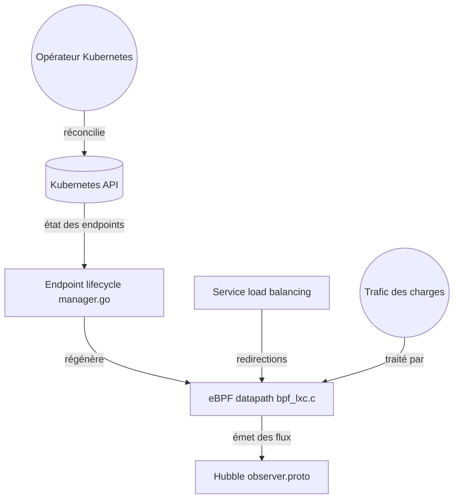

# cilium/cilium

> eBPF-based Kubernetes networking, security and observability, replacing kube-proxy.

## The problem
Classic Kubernetes networking filters on changing IP addresses and relies on heavy rules that do not hold up at scale.

## What it actually does
An eBPF-based CNI plugin: routing by overlay (VXLAN, Geneve) or native, with BGP. It load-balances without kube-proxy, applies L3 to L7 network policies based on workload identity (HTTP, DNS, gRPC filters), encrypts traffic (IPsec, WireGuard), connects several clusters (Cluster Mesh) and serves as the data plane for Gateway API. Hubble provides service maps and flows.

## How it is wired


## Trying it
```bash
# Aucune commande dans le README : il renvoie au guide d'installation de la documentation.
```

## Cost and gotchas
Free. Requires a Kubernetes cluster and an eBPF-capable Linux kernel (prerequisites detailed in the documentation). The BPF code is dual-licensed GPL-2.0 or BSD-2, the rest under Apache-2.0.

## What it is not
It is not a data or AI tool: it is a network infrastructure building block. It cannot be used outside Kubernetes.

## Alternatives
No alternative named in the README, apart from kube-proxy, which it replaces.

## For you
Ignore unless you administer the clusters that host your MLOps workloads yourself: it is not a data science tool.
