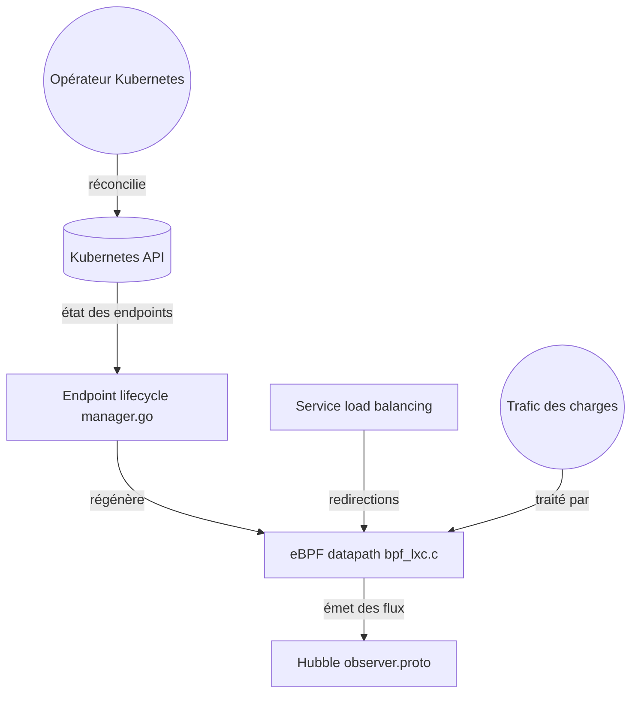

# cilium/cilium

> Réseau, sécurité et observabilité Kubernetes fondés sur eBPF, qui remplacent kube-proxy.

## Le problème
Le réseau Kubernetes classique filtre sur des adresses IP changeantes et passe par des règles lourdes qui ne tiennent pas à grande échelle.

## Ce que ça fait vraiment
Un plugin CNI à base d'eBPF : routage par overlay (VXLAN, Geneve) ou natif, avec BGP. Il équilibre la charge sans kube-proxy, applique des politiques réseau L3 à L7 selon l'identité des charges (filtres HTTP, DNS, gRPC), chiffre le trafic (IPsec, WireGuard), connecte plusieurs clusters (Cluster Mesh) et sert de plan de données Gateway API. Hubble fournit cartes de services et flux.

## Comment c'est branché


## Essayer
```bash
# Aucune commande dans le README : il renvoie au guide d'installation de la documentation.
```

## Coût et pièges
Gratuit. Nécessite un cluster Kubernetes et un noyau Linux compatible eBPF (prérequis détaillés dans la documentation). Le code BPF est sous double licence GPL-2.0 ou BSD-2, le reste sous Apache-2.0.

## Ce que ce n'est pas
Ce n'est pas un outil de données ou d'IA : c'est une brique d'infrastructure réseau. Ce n'est pas utilisable hors Kubernetes.

## Alternatives
Aucune alternative nommée dans le README, hormis kube-proxy, qu'il remplace.

## Pour toi
À ignorer sauf si tu administres toi-même les clusters qui portent tes charges MLOps : ce n'est pas un outil de data science.

