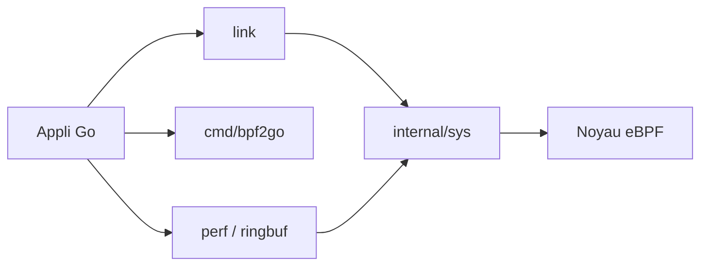

# cilium/ebpf

> Pure Go library to load, compile and debug eBPF programs.

## The problem
Handling eBPF from a Go process without heavy C dependencies is tricky.

## What it actually does
Packages `asm` (assembler), `link` (attaching to hooks), `perf` and `ringbuf` (reading events), `btf`, `features`, `rlimit`, `pin`, and `cmd/bpf2go`, which compiles C and generates the Go loading code. Linux (amd64, arm64) and Windows amd64 are supported.

## How it is wired


## Trying it
```bash
# Aucune commande dans le README : voir le guide en ligne "Getting Started" (ebpf-go.dev)
```

## Cost and gotchas
Free; assumes a recent Linux kernel (CI on LTS ≥ 4.4 "should work") and the rights to load eBPF. Strict AI policy for contributions.

## What it is not
Not a ready-to-use observability tool: it is a building block for creating one.

## Alternatives
No alternative named in the README.

## For you
Ignore unless you need kernel observability in Go: outside the data/AI core, even if useful in very low-level MLOps.
