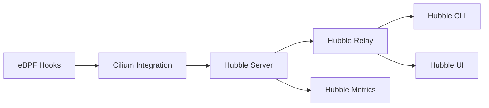

# cilium/hubble

> Distributed network observability and security for Kubernetes, built on Cilium and eBPF.

## The problem
Knowing which services communicate, where a connection fails (DNS, TCP, HTTP) and what the network policy blocks.

## What it actually does
`hubble observe` CLI to read flows (DNS, HTTP, TCP/UDP, Kafka, policy denials), Hubble server inside Cilium, multi-node Relay, Prometheus metrics and a service-map UI (beta). JSON allowlist/denylist filters, config export.

## How it is wired


## Trying it
```bash
hubble observe --since=1m -t l7 -o json
hubble observe --print-raw-filters -t drop -n kube-system
```

## Cost and gotchas
Free; requires a Kubernetes cluster with Cilium. Hubble UI is in beta. No installation command in the README.

## What it is not
Not an application APM: it observes the network, not the code. Without Cilium, it does not work.

## Alternatives
No alternative named in the README.

## For you
Worth watching: useful if you operate ML platforms on Kubernetes with Cilium; otherwise a heavy prerequisite.
