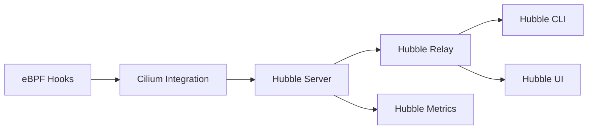

# cilium/hubble

> Observabilité réseau et sécurité distribuée pour Kubernetes, bâtie sur Cilium et eBPF.

## Le problème
Savoir quels services communiquent, où une connexion échoue (DNS, TCP, HTTP) et ce que la politique réseau bloque.

## Ce que ça fait vraiment
CLI `hubble observe` pour lire les flux (DNS, HTTP, TCP/UDP, Kafka, refus de politique), serveur Hubble dans Cilium, Relay multi-nœuds, métriques Prometheus et UI de carte de services (bêta). Filtres allowlist/denylist JSON, export de config.

## Comment c'est branché


## Essayer
```bash
hubble observe --since=1m -t l7 -o json
hubble observe --print-raw-filters -t drop -n kube-system
```

## Coût et pièges
Gratuit ; nécessite un cluster Kubernetes avec Cilium. Hubble UI est en bêta. Aucune commande d'installation dans le README.

## Ce que ce n'est pas
Pas un APM applicatif : il observe le réseau, pas le code. Sans Cilium, il ne fonctionne pas.

## Alternatives
Aucune alternative nommée dans le README.

## Pour toi
À surveiller : utile si tu opères des plateformes ML sous Kubernetes avec Cilium ; sinon prérequis lourd.

