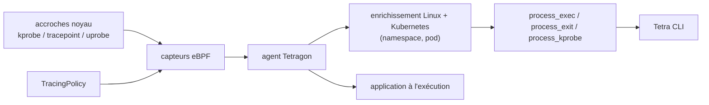

# cilium/tetragon

> Security observability and runtime policy enforcement, via eBPF, in Kubernetes.

## The problem
Knowing that a container launched an unexpected binary, read a sensitive file or opened an outbound
connection requires kernel probes; correlating them with a pod and a namespace requires something else again.

## What it actually does
Observes critical kernel hook points through its eBPF sensors and produces events enriched with Linux **and**
Kubernetes metadata. By default it emits `process_exec` and `process_exit`, i.e. the full process
lifecycle. For finer-grained cases, generic tracing produces `process_kprobe`, `process_tracepoint` and
`process_uprobe`, driven by `TracingPolicy` objects: network observability, file name access, credential
monitoring, privileged executions. It does not just detect: it can react to significant events.

## How it is wired

## Trying it
No command is written in the README: it points to the official getting-started guides
(trial on Kubernetes, trial on Linux, deployment, Tetra CLI installation).

## Cost and gotchas
Free, but eBPF requires a recent kernel and elevated privileges on the nodes. The volume of
`process_exec` events on a busy cluster is the real cost: plan for storage and a pipeline.

## What it is not
Not a SIEM nor an event store: Tetragon produces the stream, collection and correlation
happen elsewhere. Not useful outside Linux. The README is a routing page: everything concrete is in
the external documentation, nothing is reproducible from the repository alone.

## Alternatives
No alternative named in the README.

## For you
Worth knowing if your models run in a constrained cluster; otherwise it is an SRE topic.
