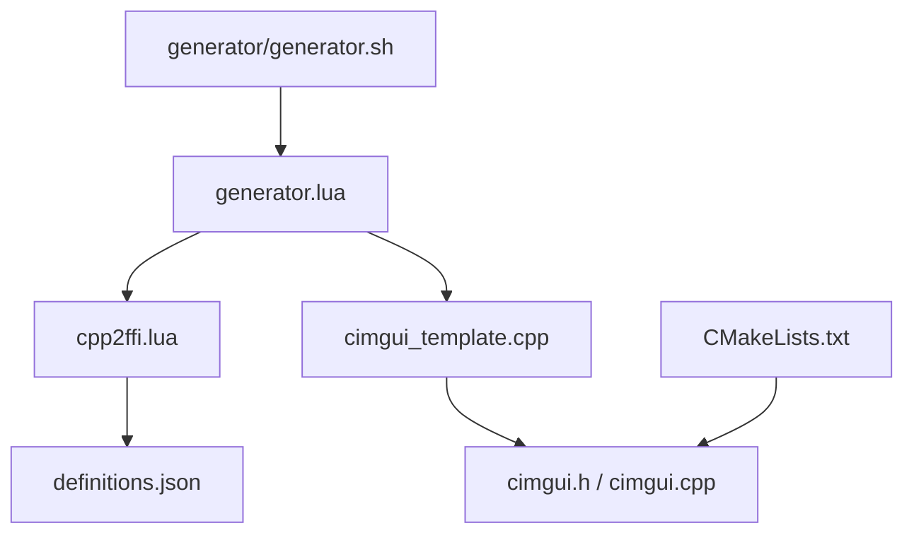

# cimgui/cimgui

> Automatically generated C wrapper for Dear ImGui, to use it from other languages.

## The problem
Dear ImGui is written in C++ and is hard to bind from languages that can only interface with C.

## What it actually does
A Lua generator parses imgui.h and produces cimgui.h and cimgui.cpp, plus JSON/Lua files of function and struct definitions for building bindings. Based on Dear ImGui 1.92.9b with the internal API. SDL, GLFW, Vulkan and OpenGL backends as examples.

## How it is wired


## Trying it
```bash
git clone --recursive https://github.com/cimgui/cimgui.git
git submodule update --init --recursive
```

## Cost and gotchas
Makefile or CMake; the generator requires LuaJIT and a C++ compiler. Functions returning non-POD structs get a _c suffix.

## What it is not
Not a ready-to-use graphical interface nor a binding for a specific language.

## Alternatives
- ImGui.NET, imgui-rs, CImGui.jl: ready-made bindings for .NET, Rust and Julia.

## For you
Ignore: useful for hooking an ImGui interface from another language, not for your data/AI work.
