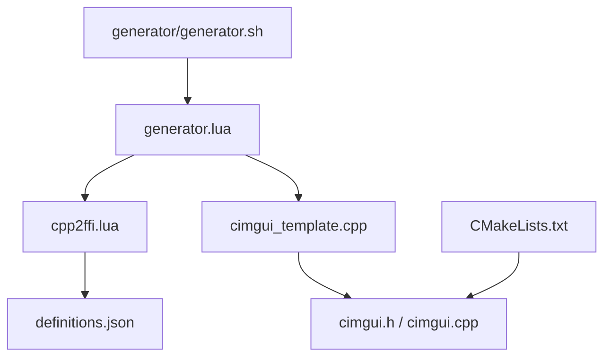

# cimgui/cimgui

> Enveloppe C générée automatiquement pour Dear ImGui, afin de l'utiliser depuis d'autres langages.

## Le problème
Dear ImGui est en C++ et difficile à lier depuis des langages qui n'interfacent que du C.

## Ce que ça fait vraiment
Un générateur Lua analyse imgui.h et produit cimgui.h et cimgui.cpp, plus des fichiers JSON/Lua de définitions de fonctions et structures pour créer des bindings. Basé sur Dear ImGui 1.92.9b avec API interne. Backends SDL, GLFW, Vulkan, OpenGL en exemples.

## Comment c'est branché


## Essayer
```bash
git clone --recursive https://github.com/cimgui/cimgui.git
git submodule update --init --recursive
```

## Coût et pièges
Makefile ou CMake ; le générateur exige LuaJIT et un compilateur C++. Les fonctions retournant des structs non POD reçoivent un suffixe _c.

## Ce que ce n'est pas
Pas une interface graphique prête à l'emploi ni un binding pour un langage précis.

## Alternatives
- ImGui.NET, imgui-rs, CImGui.jl : bindings déjà faits pour .NET, Rust et Julia.

## Pour toi
Ignorer : utile pour brancher une interface ImGui depuis un autre langage, pas pour ton travail data/IA.

