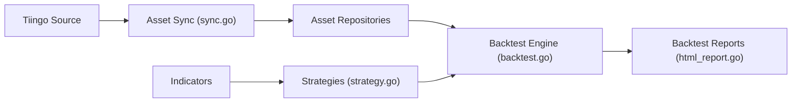

# cinar/indicator

> Go library of technical analysis indicators and backtesting, for research and teaching.

## The problem
Computing indicators (RSI, MACD, Bollinger...) and testing strategies on historical data without starting from scratch.

## What it actually does
- Over 80 indicators (trend, momentum, volatility, volume) and valuation (PV, NPV).
- Version 2: Go streams (channels) as input and output, generics, test coverage of at least 90%.
- Example strategies, backtest with HTML report, Sharpe and Sortino ratios.
- Asset repositories: file system, memory, Tiingo.

## How it is wired


## Trying it
```bash
go get github.com/cinar/indicator/v2
docker run -it --rm -v $(pwd)/output:/app/output ghcr.io/cinar/indicator:latest --api-key YOUR_TIINGO_API_KEY --days 365 --assets aapl msft googl --strategies apo,macd,rsi
```

## Cost and gotchas
Free Tiingo key for the data. AGPLv3 license for v2 with a commercial license in parallel; v1 is under MIT.

## What it is not
Not investment advice: the README stresses the limits of backtest results.

## Alternatives
The README cites Indicator TS, a TypeScript version.

## For you
Worth watching: fine for prototyping signals in Go; in Python you will go faster with the pandas ecosystem, and the AGPL weighs on commercial use.
