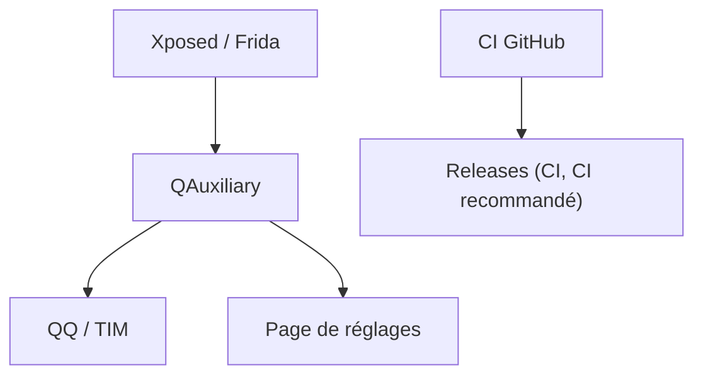

# cinit/QAuxiliary

> Open-source Xposed module that adds features to the QQ and TIM clients on Android.

## The problem
The QQ and TIM clients lack settings and features that users want to add.

## What it actually does
Once enabled in Xposed, or via Frida with root, it adds a settings page inside QQ or TIM. It loads code at runtime (byte-buddy, in-memory dex), which explains its absence from Google Play. Rolling releases: CI and "recommended CI".

## How it is wired


## Trying it
```bash
git clone https://github.com/cinit/QAuxiliary
cd QAuxiliary
git submodule update --init
./gradlew :app:assembleDebug
```

## Cost and gotchas
Free. Build: JDK 17+, Android SDK, Ninja 1.11+, 14 submodules. Android 7.0 minimum. EULA CC BY-NC-SA 4.0 (non-commercial). The authors may stop or delete the project at any time.

## What it is not
Not a standalone messaging tool. Not a module for money features, history modification or mass sending: these are excluded by the authors.

## Alternatives
No alternative named in the README (based on QNotified).

## For you
Ignore: modification of a Chinese consumer app, unrelated to data / AI / MLOps work.
