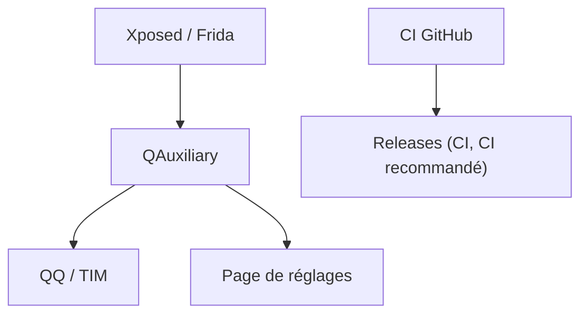

# cinit/QAuxiliary

> Module Xposed open source qui ajoute des fonctions aux clients QQ et TIM sous Android.

## Le problème
Les clients QQ et TIM manquent de réglages et de fonctions que les utilisateurs veulent ajouter.

## Ce que ça fait vraiment
Une fois activé dans Xposed, ou via Frida avec root, il ajoute une page de réglages dans QQ ou TIM. Il charge du code à l'exécution (byte-buddy, dex en mémoire), ce qui explique l'absence sur Google Play. Releases en rolling : CI et « CI recommandé ».

## Comment c'est branché


## Essayer
```bash
git clone https://github.com/cinit/QAuxiliary
cd QAuxiliary
git submodule update --init
./gradlew :app:assembleDebug
```

## Coût et pièges
Gratuit. Compilation : JDK 17+, Android SDK, Ninja 1.11+, 14 sous-modules. Android 7.0 minimum. EULA CC BY-NC-SA 4.0 (non commercial). Les auteurs peuvent arrêter ou supprimer le projet à tout moment.

## Ce que ce n'est pas
Pas un outil de messagerie autonome. Pas un module pour fonctions d'argent, de modification de l'historique ou d'envoi en masse : exclues par les auteurs.

## Alternatives
Aucune alternative nommée dans le README (base : QNotified).

## Pour toi
Ignorer : modification d'une application grand public chinoise, sans lien avec un travail data / IA / MLOps.

