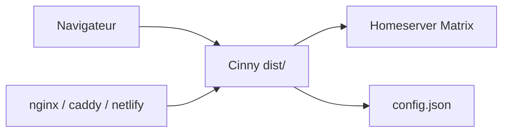

# cinnyapp/cinny

> Matrix protocol web client with a simple interface, for anyone who wants a sober instant messenger.

## The problem
Matrix clients are often heavy or austere; an easy-to-pick-up messenger is needed.

## What it actually does
Provides a Matrix messaging web application, usable at app.cinny.in or self-hostable from the release tarball or a Docker image. Default servers and explore pages are set in `config.json`. A desktop application exists in a separate repository. The README does not describe the messaging features in detail.

## How it is wired
Simplified diagram based on the fiche, no diagram provided.

## Trying it
The README gives no command: it says to download the GitHub releases tarball and serve `dist/` with a web server, or to pull the Docker image `ajbura/cinny`.

## Cost and gotchas
Free. You need an account on a Matrix homeserver and server redirects to serve the assets (or hash routing). PRs are suspended while matrix-js-sdk is being replaced by an in-house SDK.

## What it is not
Not a Matrix server: it is only the client. AGPL-3.0 license, with code-sharing obligations if a modified version is offered as a network service.

## Alternatives
No alternative named in the README.

## For you
Ignore: consumer messaging unrelated to data / AI / MLOps work, unless you need to host a Matrix client.
