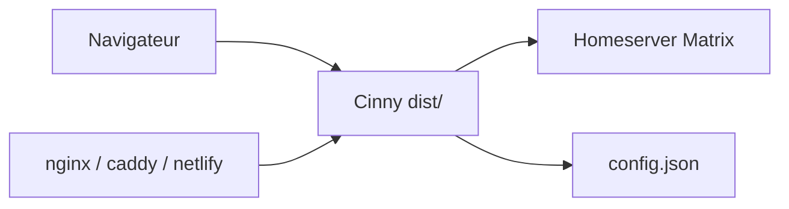

# cinnyapp/cinny

> Client web du protocole Matrix à l'interface simple, pour qui veut une messagerie instantanée sobre.

## Le problème
Les clients Matrix sont souvent chargés ou austères ; il faut une messagerie facile à prendre en main.

## Ce que ça fait vraiment
Fournit une application web de messagerie Matrix, utilisable sur app.cinny.in ou hébergeable soi-même à partir du tarball des releases ou d'une image Docker. Les serveurs par défaut et pages d'exploration se règlent dans `config.json`. Une application de bureau existe dans un dépôt séparé. Le README ne décrit pas les fonctions de messagerie en détail.

## Comment c'est branché
Schéma simplifié d'après la fiche, sans diagramme fourni.

## Essayer
Le README ne donne pas de commande : il indique de télécharger le tarball des releases GitHub et de servir `dist/` avec un serveur web, ou de tirer l'image Docker `ajbura/cinny`.

## Coût et pièges
Gratuit. Il faut un compte sur un homeserver Matrix et des redirections serveur pour servir les assets (ou le routage par hash). Les PR sont suspendues pendant le remplacement de matrix-js-sdk par un SDK maison.

## Ce que ce n'est pas
Pas un serveur Matrix : c'est seulement le client. Licence AGPL-3.0, avec les obligations de partage du code en cas de service réseau modifié.

## Alternatives
Aucune alternative nommée dans le README.

## Pour toi
À ignorer : messagerie grand public sans lien avec le travail data / IA / MLOps, sauf besoin de héberger un client Matrix.

