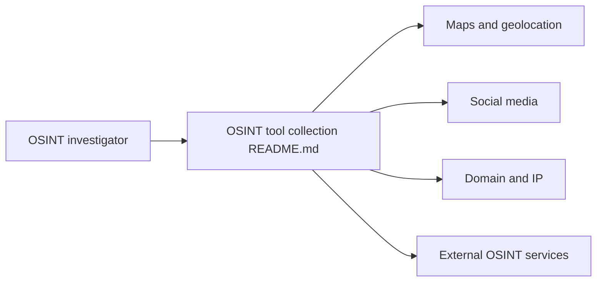

# cipher387/osint_stuff_tool_collection

> List of more than a thousand open-source intelligence services and tools, sorted by theme.

## The problem
OSINT tools are scattered, often abandoned, and their names change.

## What it actually does
A giant README, organized by section: maps and geolocation, social networks, domains and IPs, images, search engines, archives, messaging, e-mails, usernames, companies. The author deliberately keeps dead tools so that equivalents can be found. He highlights Consensus (CLI) and the Netlas Cookbook.

## How it is wired

## Trying it
No documented command: you browse the README by category and follow the links to external services.

## Cost and gotchas
Free for the list; some listed services are paid or require an account. No license declared on the repository. Many dead links, by the author's own admission.

## What it is not
Not a tool: a directory of links, with no verification of their reliability. Some sections (data leaks, people search) call for legal and ethical caution.

## Alternatives
No alternative named in the README.

## For you
Ignore: outside the data/AI/MLOps scope, unless you have an investigation or open-source watch assignment.
