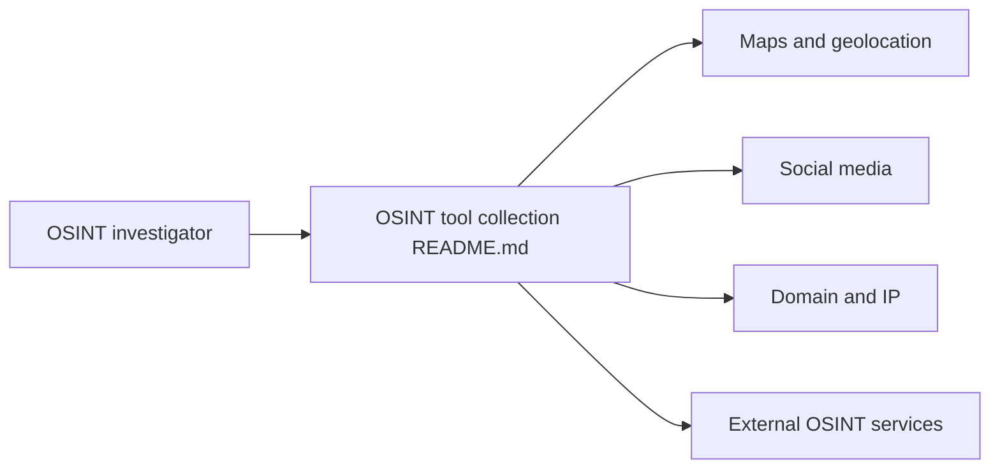

# cipher387/osint_stuff_tool_collection

> Liste de plus de mille services et outils de renseignement en sources ouvertes, classés par thème.

## Le problème
Les outils OSINT sont dispersés, souvent abandonnés, et leurs noms changent.

## Ce que ça fait vraiment
Un README géant, rangé par rubriques : cartes et géolocalisation, réseaux sociaux, domaines et IP, images, moteurs de recherche, archives, messageries, courriels, pseudos, entreprises. L'auteur garde les outils morts exprès pour qu'on retrouve des équivalents. Il met en avant Consensus (CLI) et le Netlas Cookbook.

## Comment c'est branché

## Essayer
Aucune commande documentée : on parcourt le README par catégorie et on suit les liens vers des services externes.

## Coût et pièges
Gratuit pour la liste ; des services listés sont payants ou exigent un compte. Aucune licence déclarée sur le dépôt. Nombreux liens morts, de l'aveu de l'auteur.

## Ce que ce n'est pas
Pas un outil : une annuaire de liens, sans vérification de leur fiabilité. Certaines rubriques (fuites de données, recherche de personnes) demandent prudence légale et éthique.

## Alternatives
Aucune alternative nommée dans le README.

## Pour toi
Ignorer : hors périmètre data/IA/MLOps, sauf mission d'enquête ou de veille en sources ouvertes.

