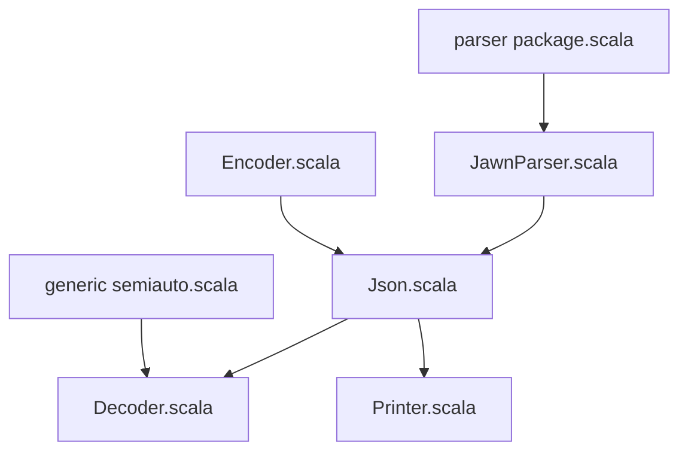

# circe/circe

> JSON library for Scala and Scala.js, for those writing functional JVM services.

## The problem
Reading and writing JSON in Scala through types, without handling trees by hand.

## What it actually does
A parser (JawnParser) builds a Json tree. Decoder and Encoder convert this tree to and from Scala types, with automatic derivation in the generic module. Printer.scala prints the result. The README mostly lists users (Spotify, Stripe, Zalando...), companion modules (YAML, fs2, Jackson) and related projects.

## How it is wired

## Trying it
No documented command: the README points to the website guide.

## Cost and gotchas
Free. Requires Scala and a JVM build tool (the README does not give the dependency coordinates). Generic derivation is reputed to be heavy at compile time: a dedicated experimental module exists.

## What it is not
Not a web framework nor a data tool: only the JSON layer.

## Alternatives
jsoniter-scala-circe speeds up parsing and printing of the circe AST; borer reuses circe codecs for CBOR.

## For you
Ignore unless you do Spark or Scio in Scala: everything is in Python for you, so it is useless.
