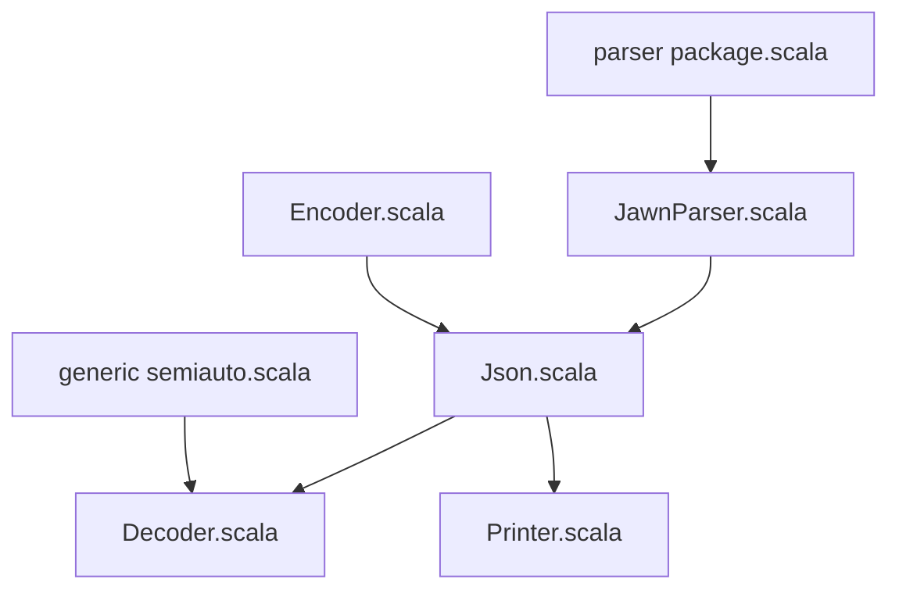

# circe/circe

> Bibliothèque JSON pour Scala et Scala.js, pour qui code des services JVM fonctionnels.

## Le problème
Lire et écrire du JSON en Scala en passant par des types, sans manipuler des arbres à la main.

## Ce que ça fait vraiment
Un parseur (JawnParser) construit un arbre Json. Decoder et Encoder convertissent cet arbre vers et depuis les types Scala, avec dérivation automatique dans le module generic. Printer.scala imprime le résultat. Le README liste surtout des utilisateurs (Spotify, Stripe, Zalando...), des modules compagnons (YAML, fs2, Jackson) et des projets liés.

## Comment c'est branché

## Essayer
Aucune commande documentée : le README renvoie au guide du site.

## Coût et pièges
Gratuit. Il faut Scala et un outil de build JVM (le README ne donne pas les coordonnées de dépendance). Dérivation générique réputée lourde en compilation : un module expérimental dédié existe.

## Ce que ce n'est pas
Pas un framework web ni un outil de données : uniquement la couche JSON.

## Alternatives
jsoniter-scala-circe accélère le parsing et l'impression de l'AST circe ; borer réutilise les codecs circe pour CBOR.

## Pour toi
À ignorer sauf si tu fais du Spark ou du Scio en Scala : tout en Python chez toi, ça ne sert à rien.

