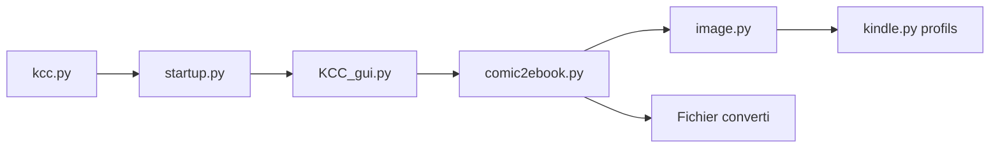

# ciromattia/kcc

> Converter of manga and comics into full-screen files for Kindle, Kobo and reMarkable e-readers.

## The problem
Most e-reader conversions add margins, produce large files and washed-out blacks.

## What it actually does
Takes image folders, CBZ, CBR, CB7, EPUB or PDF and outputs MOBI/AZW3, EPUB/KEPUB, CBZ, PDF or images, tuned per device profile. Downsizes to the screen resolution (a 600 MB volume drops to 100 MB), fixes black levels, removes the rainbow effect on color screens, detects double pages. Graphical interface and CLI tools `c2e` and `c2p`.

## How it is wired


## Trying it
```bash
python -m venv venv
source venv/bin/activate
pip install -r requirements.txt
python kcc.py
```

## Cost and gotchas
Free. KindleGen (via Kindle Previewer) for MOBI, 7-Zip optional to speed things up. The MOBI for the 2025 Kindle Scribe may show blank pages: use the PDF. At startup, the application performs an online version check.

## What it is not
Not a Calibre tool, and the README advises against Calibre for modifying the output. It is not Amazon's Kindle Comic Creator.

## Alternatives
Calibre: discouraged for this format; Amazon's Kindle Comic Creator: a publishers' tool, not equivalent.

## For you
Ignore: manga reading utility unrelated to data/AI/MLOps.
