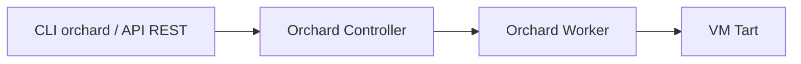

# cirruslabs/orchard

> Orchestrateur de machines virtuelles Tart sur un cluster de Mac Apple Silicon.

## Le problème
Gérer des dizaines de VM macOS sur plusieurs Mac physiques à la main est ingérable.

## Ce que ça fait vraiment
Orchard fournit un contrôleur et des workers : on crée un cluster de Mac et on pilote les VM Tart via une CLI `orchard` ou une API REST intégrée. Le mode `orchard dev` lance un contrôleur et un worker sur la machine locale. Sous macOS 15 et plus, la permission « réseau local » impose un contournement : lancer le worker en root avec `--user`, ou régler les préférences réseau.

## Comment c'est branché
Pas de graphe fourni : schéma simple tiré du README.


## Essayer
```shell
brew install openai/tools/orchard
orchard dev
```

## Coût et pièges
Matériel Apple Silicon requis. Un helper `orchard localnetworkhelper` tourne en privilège pour éviter la fenêtre de permission. La licence est présente mais non identifiée par GitHub.

## Ce que ce n'est pas
Pas un outil de CI à lui seul : c'est l'orchestration des VM. README court, le détail est dans la documentation officielle.

## Alternatives
Le README ne nomme pas d'alternative.

## Pour toi
Ignorer : utile seulement si tu gères une ferme de Mac pour de la CI macOS, pas pour du MLOps sur GPU.

