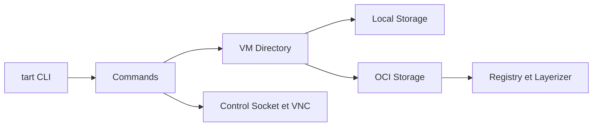

# cirruslabs/tart

> Command-line tool to create and run macOS and Linux VMs on Apple Silicon.

## The problem
Running reproducible macOS builds and tests in CI requires disposable, versioned virtual machines.

## What it actually does
Swift CLI on top of Virtualization.Framework: create, clone, run, exec, push/pull of VM images to any OCI-compatible registry, IPSW and layer cache, VNC access and a control channel to run commands in the guest. Packer plugin to automate creation.

## How it is wired


## Trying it
```bash
brew install openai/tools/tart
tart clone ghcr.io/cirruslabs/macos-tahoe-base:latest tahoe-base
tart run tahoe-base
```

## Cost and gotchas
Apple Silicon and macOS 13 minimum; the base image weighs 25 GB. License present but not identified by GitHub: read it before enterprise use.

## What it is not
Not a cross-platform tool: the runtime is centered on macOS Apple Silicon, even though the code also compiles on Linux.

## Alternatives
Tart Packer Plugin for automation; no other alternative named.

## For you
Worth watching: relevant only if your CI or builds run on Apple Silicon Macs; otherwise out of scope, and the license needs checking.
