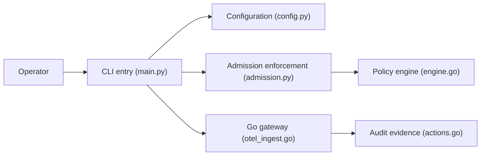

# cisco-ai-defense/defenseclaw

> Security governance layer for OpenClaw and agent runtimes: scanning, traffic inspection, audit.

## The problem
Before allowing an agent capability or observing its traffic, you need admission controls, policies and a durable audit trail.

## What it actually does
A Python operator CLI plus a Go gateway, connector hooks, policies, scanners and observability exporters. It scans capabilities before use, inspects runtime traffic, enforces admission policies and exports audit evidence. The README states that it does not prove an agent is risk-free. Installation details are on the documentation site, not in the README.

## How it is wired


## Trying it
```bash
git clone https://github.com/cisco-ai-defense/defenseclaw.git
cd defenseclaw
make build
make test
```
These targets are for contributors only; installation goes through the documentation site.

## Cost and gotchas
Free. Toolchain: Python >=3.10 <3.14, Go 1.26.4; the repository serves as a development contract, and installing a managed host is done through the official update scripts. Not all internal links were checked.

## What it is not
Not a security guarantee: it is an enforcement and evidence layer. It governs OpenClaw and compatible runtimes, not just any agent.

## Alternatives
No alternative named in the README.

## For you
Worth watching: relevant if you deploy agents in an enterprise and need audit trails; without OpenClaw, the practical interest is limited.
