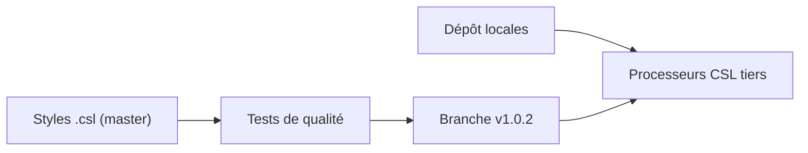

# citation-style-language/styles

> Official repository of CSL citation styles, used by reference-management software.

## The problem
Format citations and bibliographies according to hundreds of editorial standards, without rewriting each style.

## What it actually does
Hosts XML style files for journals, publishers and guides, selected according to inclusion criteria (quality, grounding in an official guide, interest to a broad audience). The `master` branch tracks the latest version of CSL, while branches `v1.0`, `v1.0.1`, `v1.0.2` provide stable locations and receive updates only if the tests pass. Locale languages are in another repository.

## How it is wired

## Trying it
No command documented in the README: it points to the guides (requirements, development, submission).

## Cost and gotchas
Free. The styles are under CC BY-SA 3.0: credit the CSL project with a link and keep the authors. The catalog detects no license at repository level. Integrators must pick the version branch, not `master`.

## What it is not
Not citation software: you need a third-party CSL processor. Styles for personal or internal use are rejected.

## Alternatives
None cited in the README.

## For you
Watch: useful if you write articles or reports citing sources; the styles are to be consumed through your reference manager.
