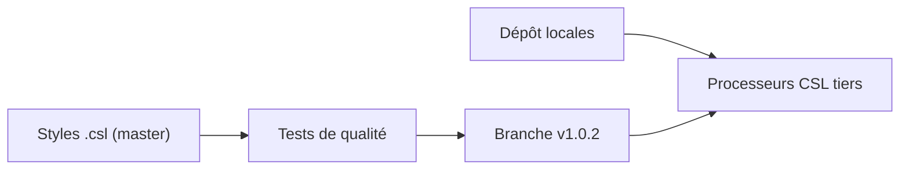

# citation-style-language/styles

> Dépôt officiel des styles de citation CSL, utilisés par des logiciels de gestion de références.

## Le problème
Mettre en forme citations et bibliographies selon des centaines de normes éditoriales, sans réécrire chaque style.

## Ce que ça fait vraiment
Héberge des fichiers de styles XML pour revues, éditeurs et guides, sélectionnés selon des critères d'inclusion (qualité, appui sur un guide officiel, intérêt pour un large public). La branche `master` suit la dernière version de CSL, des branches `v1.0`, `v1.0.1`, `v1.0.2` fournissent des emplacements stables et ne reçoivent les mises à jour que si les tests passent. Les langues locales sont dans un autre dépôt.

## Comment c'est branché

## Essayer
Aucune commande documentée dans le README : il renvoie aux guides (exigences, développement, soumission).

## Coût et pièges
Gratuit. Les styles sont sous CC BY-SA 3.0 : mentionner le projet CSL avec un lien et conserver les auteurs. Le catalogue ne détecte aucune licence au niveau du dépôt. Les intégrateurs doivent choisir la branche de version, pas `master`.

## Ce que ce n'est pas
Pas un logiciel de citation : il faut un processeur CSL tiers. Les styles à usage personnel ou interne sont refusés.

## Alternatives
Aucune citée dans le README.

## Pour toi
Surveiller : utile si tu rédiges des articles ou rapports citant des sources ; les styles sont à consommer via ton gestionnaire de références.

