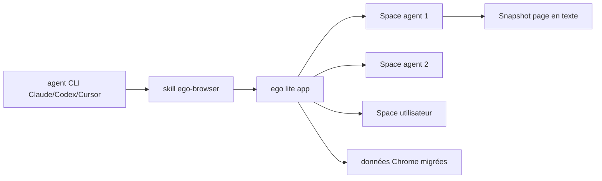

# citrolabs/ego-lite

> macOS browser where the agent works in its own space while you keep yours.

## The problem
Browser automation tools drive a third-party browser: logged-in sessions don't carry over,
the connection is unstable, and the agent takes control away from you.

## What it actually does
A single browser, shared between you and your agents via "Spaces" — isolated
workspaces inside the same application. Each agent has its own, several
run in parallel without stealing each other's tabs, and you can see which one is active so you can
take over or stop it. The `ego-browser` layer exposes the browser as in-page JavaScript
functions (snapshot, fill, click, wait, navigate, capture): the agent
writes a snippet that chains several steps in one pass, instead of a loop of CLI
calls. Optional migration of Chrome data on first launch
(sessions, cookies, extensions, bookmarks).

## How it is wired


## Trying it
```bash
npx skills add citrolabs/ego-lite
```

## Cost and gotchas
macOS only today, Windows in closed beta, Linux planned. Free.
Data collection is claimed to be narrow: simple product signals, for example whether
ego lite is set as the default browser. Migrating your Chrome data gives
the agent access to all your logged-in sessions — that is the selling point and the
main risk.

## What it is not
Not an automation library: it is a full browser to install.
No license declared in the README. The comparison table and the benchmarks
(up to 2.5× faster) are produced by the vendor, on four tasks chosen
by them. The announced experience accumulation is marked "coming soon".

## Alternatives
- Browser-Use: library driving a third-party browser, with no browser of its own.
- agent-browser (Vercel): same family, with compressed semantic input.
- ChatGPT Atlas / Perplexity Comet: AI browsers, but only their built-in agent drives them.

## For you
Worth watching for agent-driven authenticated scraping; the exposure of your
Chrome sessions deserves some thought before saying yes to the migration.
