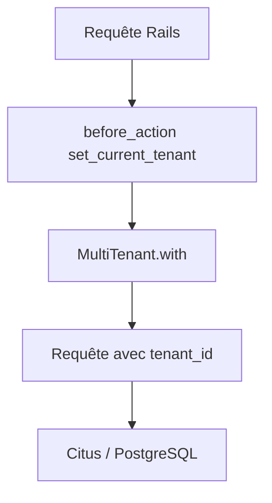

# citusdata/activerecord-multi-tenant

> Rails gem that adds tenant context to queries, to distribute multi-tenant databases on Citus.

## The problem
In a distributed multi-tenant database, queries without a tenant identifier are routed inefficiently.

## What it actually does
You annotate models with `multi_tenant :customer`, then wrap the code in `MultiTenant.with(customer)`. The gem adds `tenant_id` to queries and writes. A write-only mode lets you fill `tenant_id` progressively before enforcing the tenant.

## How it is wired
Simplified diagram based on the sheet, no diagram provided.



## Trying it
```ruby
gem 'activerecord-multi-tenant'

MultiTenant.with(customer) do
  site = Site.find(params[:site_id])
end
MultiTenant.enable_write_only_mode
```

## Cost and gotchas
Free. Requires Ruby on Rails and non-null `tenant_id` columns. Citus is not mandatory according to the text but it is the target. Last push in November 2024.

## What it is not
Not a Python tool nor a database extension. Tables not tied to a tenant must be kept out of the gem.

## Alternatives
- acts_as_tenant: the gem this one derives from, cited in the credits.

## For you
Ignore: specific to Rails and Citus, not updated for a year, unrelated to a data or MLOps workflow.
