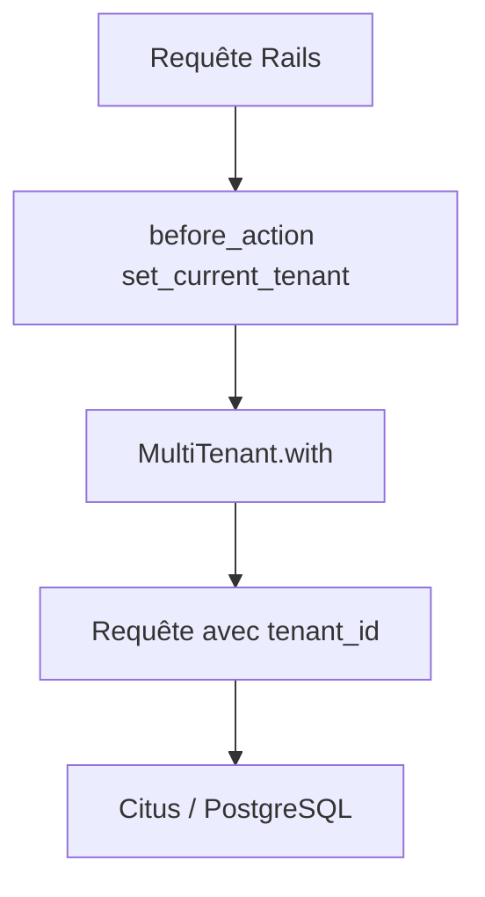

# citusdata/activerecord-multi-tenant

> Gem Rails qui ajoute le contexte de locataire aux requêtes, pour répartir des bases multi-tenant sur Citus.

## Le problème
Dans une base multi-tenant répartie, des requêtes sans identifiant de locataire sont routées de façon inefficace.

## Ce que ça fait vraiment
On annote les modèles avec `multi_tenant :customer`, puis on enveloppe le code dans `MultiTenant.with(customer)`. La gem ajoute `tenant_id` aux requêtes et aux écritures. Un mode écriture seule permet de remplir progressivement `tenant_id` avant d'imposer le locataire.

## Comment c'est branché
Schéma simplifié d'après la fiche, sans diagramme fourni.



## Essayer
```ruby
gem 'activerecord-multi-tenant'

MultiTenant.with(customer) do
  site = Site.find(params[:site_id])
end
MultiTenant.enable_write_only_mode
```

## Coût et pièges
Gratuit. Il faut Ruby on Rails et des colonnes `tenant_id` non nulles. Citus n'est pas obligatoire d'après le texte mais c'est la cible. Dernier push en novembre 2024.

## Ce que ce n'est pas
Pas un outil Python ni une extension de base de données. Les tables non liées à un locataire doivent rester hors de la gem.

## Alternatives
- acts_as_tenant : la gem dont celle-ci est issue, citée dans les crédits.

## Pour toi
À ignorer : spécifique à Rails et Citus, plus mise à jour depuis un an, sans lien avec un flux data ou MLOps.

