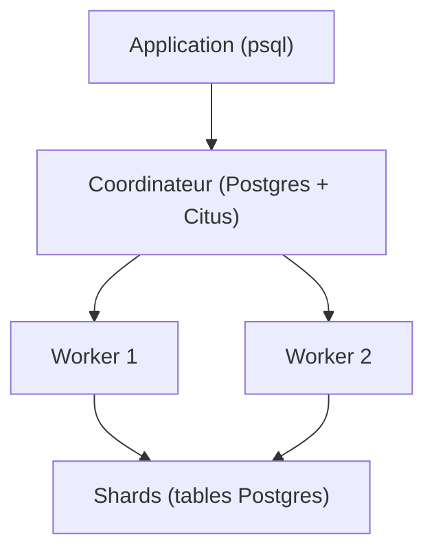

# citusdata/citus

> PostgreSQL extension that distributes tables across a cluster, for analytics, multi-tenant SaaS and time series.

## The problem
An application outgrows a single PostgreSQL node: CPU saturated, not enough memory, autovacuum falling behind.

## What it actually does
Adds to PostgreSQL tables distributed in fragments (shards), replicated reference tables, a distributed query engine, columnar storage (`USING columnar`) and schema-based sharding. A coordinator stores the metadata and sends SQL to the workers; co-located tables allow efficient joins and foreign keys. High availability with Patroni.

## How it is wired

Diagram inferred from the README; no code diagram was provided.

## Trying it
```bash
docker run -d --name citus -p 5500:5432 -e POSTGRES_PASSWORD=mypassword citusdata/citus
docker exec -it citus psql -U postgres
```
```sql
SELECT create_distributed_table('events', 'device_id');
```

## Cost and gotchas
Free in the community edition (AGPL-3.0). The managed Azure service (Elastic Clusters) is paid. You must add `shared_preload_libraries = 'citus'` and restart. On columnar tables: no updates, deletes or foreign keys.

## What it is not
Not a new database: it is a PostgreSQL extension. Columnar storage is loaded in batches to compress well. Schema changes still go through the coordinator.

## Alternatives
No alternative named in the README.

## For you
Adopt it if your volumes exceed a single PostgreSQL (analytics or time series): you keep SQL and the Postgres ecosystem, with an AGPL license to be aware of.
