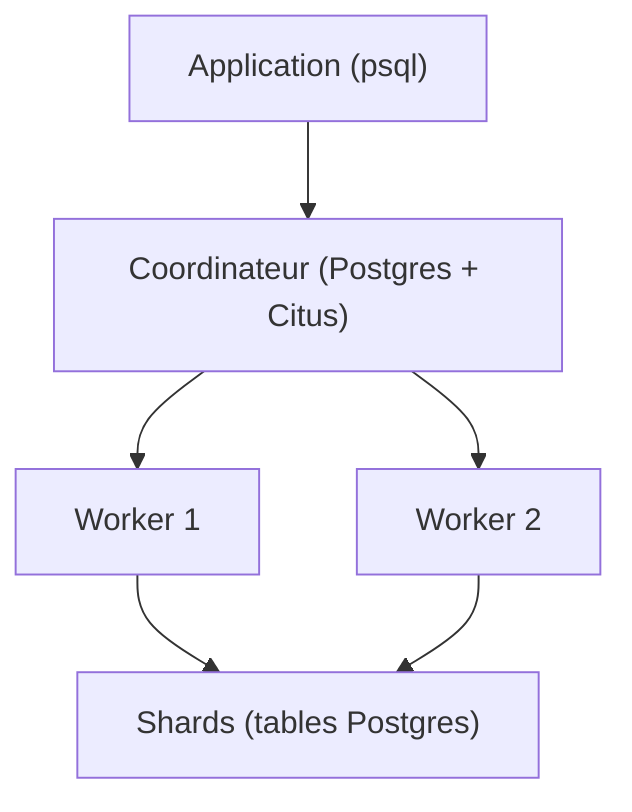

# citusdata/citus

> Extension PostgreSQL qui distribue les tables sur un cluster, pour analytique, SaaS multi-locataire et séries temporelles.

## Le problème
Une application dépasse un seul nœud PostgreSQL : CPU saturé, mémoire insuffisante, autovacuum en retard.

## Ce que ça fait vraiment
Ajoute à PostgreSQL les tables distribuées par fragments (shards), les tables de référence répliquées, un moteur de requêtes distribué, le stockage en colonnes (`USING columnar`) et le sharding par schéma. Un coordinateur stocke les métadonnées et envoie du SQL aux workers ; les tables colocalisées permettent jointures et clés étrangères efficaces. Haute disponibilité avec Patroni.

## Comment c'est branché

Diagramme déduit du README, aucun diagramme du code fourni.

## Essayer
```bash
docker run -d --name citus -p 5500:5432 -e POSTGRES_PASSWORD=mypassword citusdata/citus
docker exec -it citus psql -U postgres
```
```sql
SELECT create_distributed_table('events', 'device_id');
```

## Coût et pièges
Gratuit en communauté (AGPL-3.0). Le service géré Azure (Elastic Clusters) est payant. Il faut ajouter `shared_preload_libraries = 'citus'` et redémarrer. Sur tables en colonnes : pas de mise à jour, suppression ni clés étrangères.

## Ce que ce n'est pas
Pas une base nouvelle : c'est une extension de PostgreSQL. Le stockage en colonnes se charge en lot pour bien compresser. Les modifications de schéma passent encore par le coordinateur.

## Alternatives
Aucune alternative nommée dans le README.

## Pour toi
À adopter si tes volumes dépassent un PostgreSQL unique (analytique ou séries temporelles) : tu gardes SQL et l'écosystème Postgres, avec une licence AGPL à connaître.

