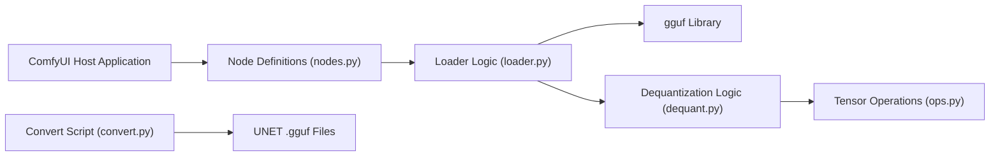

# city96/ComfyUI-GGUF

> ComfyUI nodes to load diffusion models and T5 encoders quantized in GGUF format.

## The problem
Transformer models like Flux are large: on a modest GPU, they do not fit in memory in their original format.

## What it actually does
The repository replaces ComfyUI's "Load Diffusion Model" loader with "Unet Loader (GGUF)", and adds `*CLIPLoader (gguf)` loaders for T5. The `.gguf` files (variable-bitrate quantization, popularized by llama.cpp) go in `ComfyUI/models/unet`. LoRA loading is experimental. A `tools/` folder provides scripts to create your own quantizations. The README lists already-quantized models: flux1-dev, flux1-schnell, stable-diffusion-3.5-large and -turbo, t5_v1.1-xxl.

## How it is wired


## Trying it
```bash
git clone https://github.com/city96/ComfyUI-GGUF
pip install --upgrade gguf
```
On Windows portable, the commands use `python_embeded\python.exe -s -m pip install -r requirements.txt`.

## Cost and gotchas
Free. The README warns that the project is "very much a work in progress" and that a recent version of ComfyUI is needed. On macOS Sequoia, torch 2.4.1 is required (2.6 nightly causes an error). The "Force/Set CLIP Device" node is not part of it.

## What it is not
It is not a standalone tool nor a turnkey converter: you need ComfyUI and GGUF files. The memory saving is paid for in quality depending on the quantization level, not measured in the README. The maintainer is a single person, 242 open issues.

## Alternatives
No alternative named in the README.

## For you
Worth watching: useful if you run Flux or SD3.5 on little VRAM with ComfyUI; otherwise irrelevant, and the "WIP" status with a single maintainer is a reason not to depend on it.
