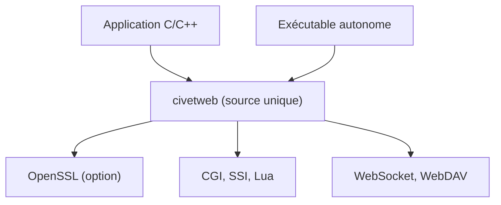

# civetweb/civetweb

> Embeddable C/C++ web server, with CGI, TLS and Lua, for adding HTTP to an application.

## The problem
Adding an HTTP interface to a C or C++ program without embedding a heavy server or a copyleft license.

## What it actually does
Library (single-file source) or standalone executable: HTTP, WebSocket, WebDAV, CGI, SSI, HTTPS via OpenSSL, HTTP and WebSocket client, server-side Lua and JavaScript. HTTP/2 is experimental. Fork of Mongoose from its MIT era (2013).

## How it is wired
Simplified diagram based on the sheet, no diagram provided.

## Trying it
No command in the README: see docs/Building.md and docs/Embedding.md.

## Cost and gotchas
Free. The license is announced as MIT but GitHub does not identify it: to be verified. 273 open issues; never copy patches from Mongoose (GPL risk).

## What it is not
Not a web framework: no high-level routing nor a Python-style development model. HTTP/2 is only experimental.

## Alternatives
- Mongoose: source of the ancestor, now GPL v2 or commercial.

## For you
Watch: useful if you need to expose an endpoint in an embedded C component, but irrelevant for Python services.
