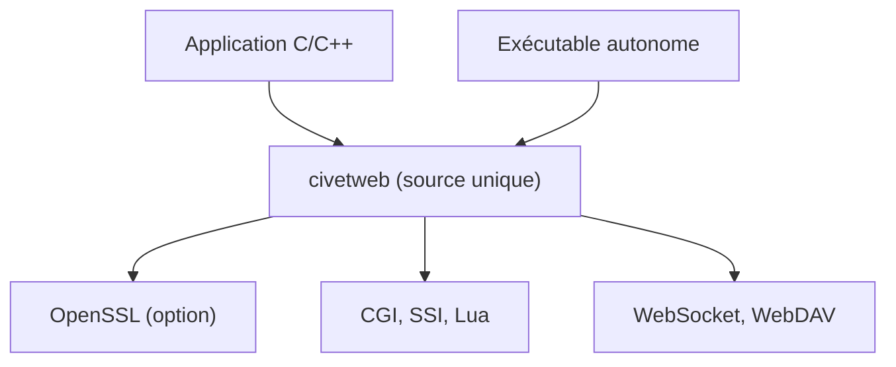

# civetweb/civetweb

> Serveur web C/C++ embarquable, avec CGI, TLS et Lua, pour ajouter du HTTP à une application.

## Le problème
Ajouter une interface HTTP à un programme C ou C++ sans embarquer un serveur lourd ni une licence copyleft.

## Ce que ça fait vraiment
Bibliothèque (source en un seul fichier) ou exécutable autonome : HTTP, WebSocket, WebDAV, CGI, SSI, HTTPS via OpenSSL, client HTTP et WebSocket, Lua et JavaScript côté serveur. HTTP/2 est expérimental. Fork de Mongoose à l'époque MIT (2013).

## Comment c'est branché
Schéma simplifié d'après la fiche, sans diagramme fourni.

## Essayer
Aucune commande dans le README : voir docs/Building.md et docs/Embedding.md.

## Coût et pièges
Gratuit. La licence est annoncée MIT mais GitHub ne l'identifie pas : à vérifier. 273 issues ouvertes ; ne jamais copier de correctifs de Mongoose (risque GPL).

## Ce que ce n'est pas
Pas un framework web : pas de routage haut niveau ni de modèle de développement façon Python. HTTP/2 n'est qu'expérimental.

## Alternatives
- Mongoose : source de l'ancêtre, désormais GPL v2 ou commercial.

## Pour toi
Surveiller : utile si tu dois exposer un endpoint dans un composant C embarqué, mais sans objet pour des services Python.

