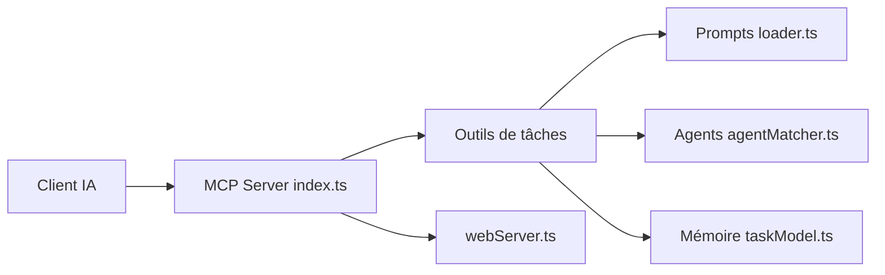

# cjo4m06/mcp-shrimp-task-manager

> MCP server that helps an agent plan, break down and track development tasks with persistent memory.

## The problem
A coding agent loses context between sessions and chains complex tasks poorly.

## What it actually does
MCP server (TypeScript) exposing tools: planning, breakdown into subtasks with dependencies, execution, research mode, project rules, reflection on a task. Tasks are saved in `DATA_DIR`. Specialized agents can be attached, prompts are customizable and translated. Interfaces: a lightweight web GUI and a separate React "Task Viewer".

## How it is wired


## Trying it
```bash
git clone https://github.com/cjo4m06/mcp-shrimp-task-manager.git
cd mcp-shrimp-task-manager
npm install
npm run build
claude --dangerously-skip-permissions --mcp-config .mcp.json
```

## Cost and gotchas
Node 18+, an MCP client. The README example launches Claude Code with `--dangerously-skip-permissions`, which removes confirmations: avoid outside an isolated environment. Last push in August 2025; 46 open issues.

## What it is not
Not a team project manager: it is a task memory for an agent. Some tool implementations were not examined.

## Alternatives
No alternative named in the README.

## For you
Worth watching: the idea of persistent task memory for agents is useful, but the repository has been stagnant for over a month and the no-permissions option is risky.
