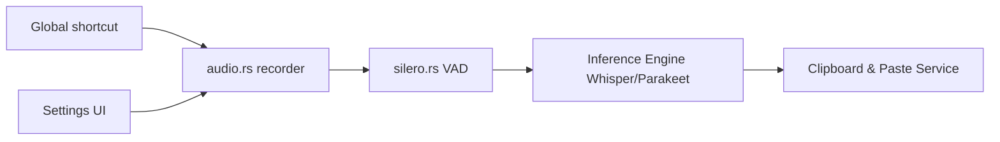

# cjpais/Handy

> Offline dictation app: keyboard shortcut, speech, text pasted into any field.

## The problem
Cloud dictation sends your voice to a third party; local tools are often closed or hard to extend.

## What it actually does
Tauri app (Rust + React): a shortcut records, a Silero VAD filter removes silences, then Whisper (Small to Large, GPU if available) or Parakeet transcribes locally, and the text is pasted via the clipboard. Control CLI (`--toggle-transcription`), history, custom models in GGML format placed in the `models` folder.

## How it is wired


## Trying it
```bash
sudo apt install ./Handy_*.deb
handy --toggle-transcription
handy --start-hidden --no-tray
```

## Cost and gotchas
Free. Microphone and accessibility permissions must be granted. Linux: input tools (xdotool, wtype, dotool) and `libgtk-layer-shell0` required; Wayland partially supported. Models of 0.5 to 1.6 GB to download.

## What it is not
Not a meeting transcription service. The README lists known limitations (Bluetooth on macOS, `fn` key on third-party keyboards, pasting of an old clipboard under load).

## Alternatives
Handy CLI (the original Python version); Superwhisper and MacWhisper, paid and limited to macOS.

## For you
Worth adopting: local dictation with no voice upload, useful for writing notes or prompts; check Wayland compatibility if you are on Linux.
