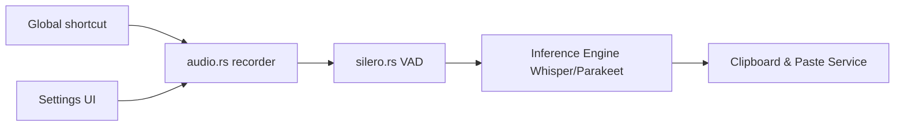

# cjpais/Handy

> Application de dictée hors ligne : raccourci clavier, parole, texte collé dans n'importe quel champ.

## Le problème
La dictée cloud envoie la voix à un tiers ; les outils locaux sont souvent fermés ou difficiles à étendre.

## Ce que ça fait vraiment
Appli Tauri (Rust + React) : un raccourci enregistre, un filtre VAD Silero retire les silences, puis Whisper (Small à Large, GPU si disponible) ou Parakeet transcrit en local, et le texte est collé via le presse-papiers. CLI de contrôle (`--toggle-transcription`), historique, modèles personnalisés au format GGML placés dans le dossier `models`.

## Comment c'est branché


## Essayer
```bash
sudo apt install ./Handy_*.deb
handy --toggle-transcription
handy --start-hidden --no-tray
```

## Coût et pièges
Gratuit. Permissions micro et accessibilité à accorder. Linux : outils de saisie (xdotool, wtype, dotool) et `libgtk-layer-shell0` nécessaires ; Wayland partiellement pris en charge. Modèles de 0,5 à 1,6 Go à télécharger.

## Ce que ce n'est pas
Pas un service de transcription de réunions. Le README liste des limites connues (Bluetooth sous macOS, touche `fn` sur claviers tiers, collage d'un ancien presse-papiers sous charge).

## Alternatives
Handy CLI (version Python d'origine) ; Superwhisper et MacWhisper, payants et limités à macOS.

## Pour toi
À adopter : dictée locale sans envoi de voix, utile pour rédiger des notes ou des prompts ; vérifie la compatibilité Wayland si tu es sous Linux.

