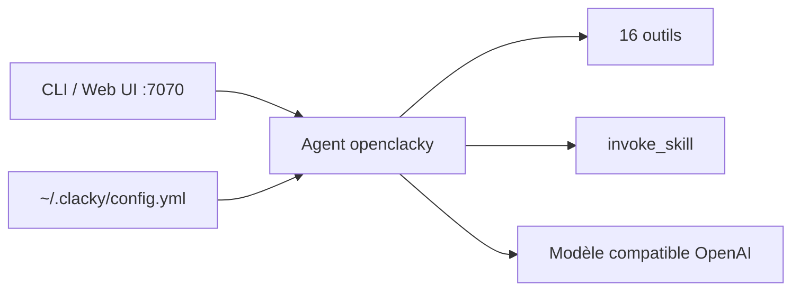

# clacky-ai/openclacky

> Open source AI agent in Ruby, CLI and web interface, with evolving skills and any OpenAI-compatible model.

## The problem
Coding agents cost a lot in tokens and are limited to one provider or one interface.

## What it actually does
Agent in a terminal or web interface (port 7070) with only 16 base tools and a meta-tool `invoke_skill`. It creates skills in natural language, updates them after execution, compresses context in the background, and integrates with Feishu, WeCom, WeChat, Discord and Telegram. macOS/Windows installers, script, `gem install`, Docker.

## How it is wired


## Trying it
```bash
gem install openclacky
openclacky
openclacky server
```

## Cost and gotchas
Model key and URL are on you. In Docker, `--network=host` to reach the host's Chrome. Set `CLACKY_ACCESS_KEY` before exposing on `0.0.0.0`.

## What it is not
The cost comparisons (~0.8x Claude Code) are internal averages whose full report is not published. Ruby 3.1+ required for the gem route.

## Alternatives
Claude Code, OpenClaw, Hermes: cited in the comparison, according to the README.

## For you
Worth watching: cost-sensitive multi-model agent, but its figures rest on its own measurements.
