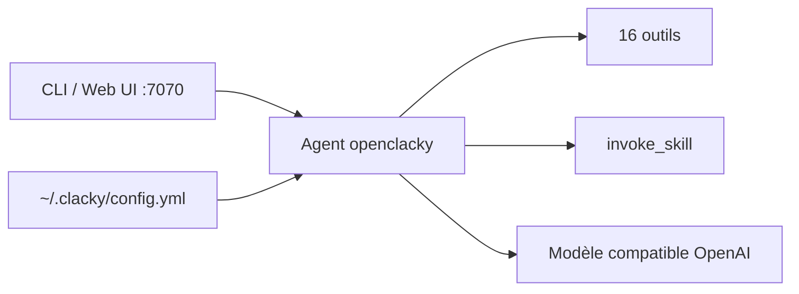

# clacky-ai/openclacky

> Agent IA open source en Ruby, CLI et interface web, avec skills évolutifs et n'importe quel modèle compatible OpenAI.

## Le problème
Les agents de code coûtent cher en tokens et se limitent à un fournisseur ou à une interface.

## Ce que ça fait vraiment
Agent en terminal ou en interface web (port 7070) avec seulement 16 outils de base et un méta-outil `invoke_skill`. Il crée des skills en langage naturel, les met à jour après exécution, compresse le contexte en tâche de fond, et s'intègre à Feishu, WeCom, WeChat, Discord et Telegram. Installateurs macOS/Windows, script, `gem install`, Docker.

## Comment c'est branché


## Essayer
```bash
gem install openclacky
openclacky
openclacky server
```

## Coût et pièges
Clé et URL du modèle à ta charge. En Docker, `--network=host` pour atteindre le Chrome de l'hôte. Définir `CLACKY_ACCESS_KEY` avant d'exposer sur `0.0.0.0`.

## Ce que ce n'est pas
Les comparaisons de coût (~0,8× Claude Code) sont des moyennes internes dont le rapport complet n'est pas publié. Ruby 3.1+ requis pour la voie gem.

## Alternatives
Claude Code, OpenClaw, Hermes : cités dans le comparatif, selon le README.

## Pour toi
À surveiller : agent multi-modèle sensible au coût, mais ses chiffres reposent sur ses propres mesures.

