# claration/Impactor

> Desktop application to install apps on iOS with an Apple ID, without going through the App Store.

## The problem
Installing an iOS application outside the App Store requires signing the app with an Apple certificate and profile, a complex step without Xcode.

## What it actually does
Reproduces what Xcode does: authenticates with Apple using your account (two-factor authentication), registers the device and the app, retrieves the certificate and profile, modifies and signs the package, installs it via `idevice`. Injection of tweaks (`.deb`, `.dylib`), generation of pairing files and P12 for SideStore or LiveContainer. A free Apple account limits you to 7 days and a few apps.

## How it is wired

```mermaid
graph TD
  A[Impactor UI mod.rs] --> B[Account authentication]
  B --> C[Developer registration]
  C --> D[Profile and entitlements profile.rs]
  D --> E[Bundle signing signer.rs]
  E --> F[Install via idevice]
  A --> G[Pairing file utilties.rs]
```


## Trying it
```sh
brew install --cask impactor
```

## Cost and gotchas
Free, with an Apple account (7 days without a paid developer program). Windows requires iTunes; Linux requires `usbmuxd` and automatic refresh is limited there.

## What it is not
Not an application marketplace. Depends on Apple services, so sensitive to their policy changes.

## Alternatives
- SideStore and AltStore: sideloading alternatives, cited in the README.

## For you
Ignore: iOS sideloading tool unrelated to data, AI or MLOps.
