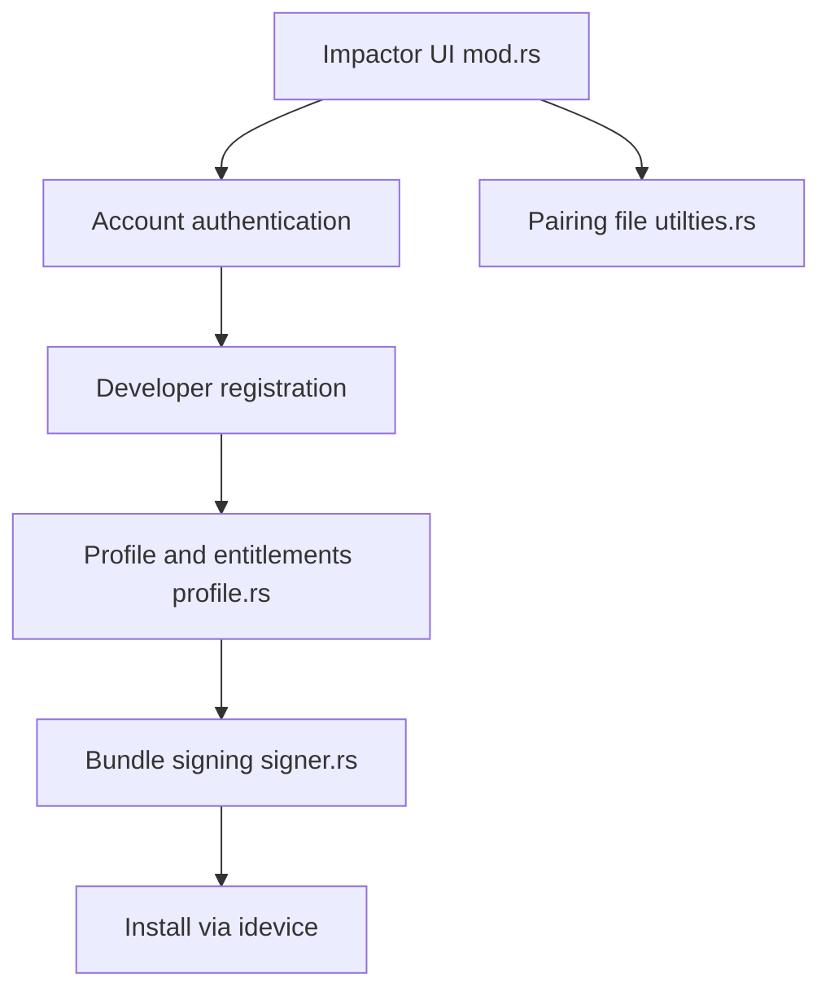

# claration/Impactor

> Application de bureau pour installer des apps sur iOS avec un identifiant Apple, sans passer par l'App Store.

## Le problème
Installer une application iOS hors App Store demande de signer l'appli avec un certificat et un profil Apple, étape complexe sans Xcode.

## Ce que ça fait vraiment
Reproduit ce que fait Xcode : s'authentifie auprès d'Apple avec ton compte (double authentification), enregistre l'appareil et l'appli, récupère certificat et profil, modifie et signe le paquet, l'installe via `idevice`. Injection de tweaks (`.deb`, `.dylib`), génération de fichiers d'appairage et de P12 pour SideStore ou LiveContainer. Un compte Apple gratuit limite à 7 jours et à peu d'apps.

## Comment c'est branché


## Essayer
```sh
brew install --cask impactor
```

## Coût et pièges
Gratuit, avec un compte Apple (7 jours sans programme développeur payant). Windows exige iTunes ; Linux exige `usbmuxd` et l'actualisation automatique y est limitée.

## Ce que ce n'est pas
Pas une place de marché d'applications. Dépend des services Apple, donc sensible à leurs changements de règles.

## Alternatives
- SideStore et AltStore : alternatives de sideloading, citées dans le README.

## Pour toi
À ignorer : outil de sideloading iOS sans rapport avec data, IA ou MLOps.

