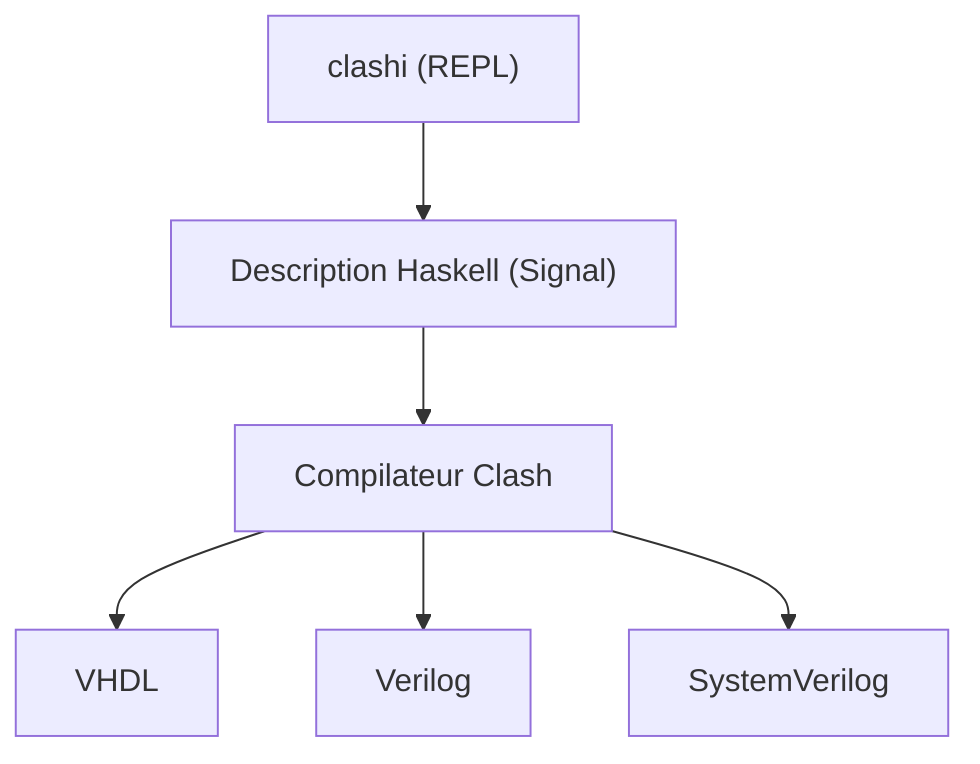

# clash-lang/clash-compiler

> Compiler that turns hardware descriptions written in Haskell into VHDL, Verilog or SystemVerilog.

## The problem
Describing digital hardware in a classic HDL is verbose and low-level; you want Haskell's typing and higher-order functions.

## What it actually does
The compiler reads Haskell designs based on `Signal` (synchronous circuits) and produces synthesizable code. It offers a REPL (`clashi`) to test without a testbench, multiple clock domains with typed crossing, and parameterizable components. A GHC compatibility matrix details the supported versions.

## How it is wired
Simplified schema based on the sheet, no diagram provided.


## Trying it
```bash
cabal v2-run -- clash
stack run -- clash
nix develop .
```

## Cost and gotchas
Free. Requires GHC and Cabal or Stack (ghcup recommended); some GHC versions make Clash very slow or buggy (9.4.8 to 9.6.2, 9.12.1 to 9.12.3). License present but not identified by GitHub. 398 open issues.

## What it is not
Not an FPGA synthesis tool: it generates HDL that another tool must synthesize.

## Alternatives
No alternative named in the README.

## For you
Ignore: hardware design in Haskell, outside the data, AI and MLOps scope.
