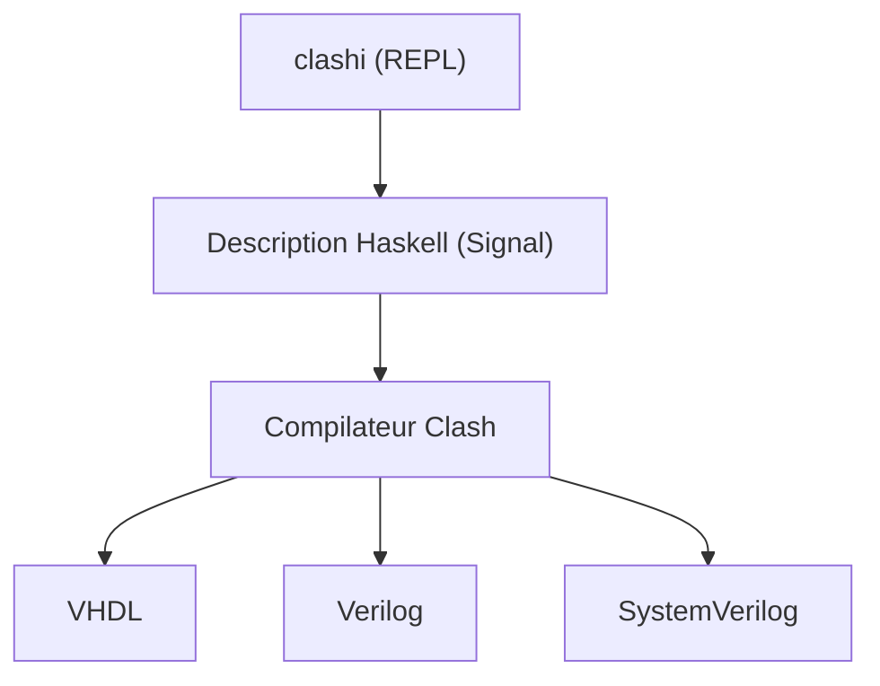

# clash-lang/clash-compiler

> Compilateur qui transforme des descriptions matérielles écrites en Haskell en VHDL, Verilog ou SystemVerilog.

## Le problème
Décrire du matériel numérique en HDL classique est verbeux et peu abstrait ; on veut le typage et les fonctions d'ordre supérieur de Haskell.

## Ce que ça fait vraiment
Le compilateur lit des conceptions Haskell basées sur des `Signal` (circuits synchrones) et produit du code synthétisable. Il offre un REPL (`clashi`) pour tester sans banc d'essai, plusieurs domaines d'horloge avec croisement typé et des composants paramétrables. Une matrice de compatibilité GHC détaille les versions supportées.

## Comment c'est branché
Schéma simplifié d'après la fiche, sans diagramme fourni.


## Essayer
```bash
cabal v2-run -- clash
stack run -- clash
nix develop .
```

## Coût et pièges
Gratuit. Il faut GHC et Cabal ou Stack (ghcup conseillé) ; certaines versions de GHC rendent Clash très lent ou boguent (9.4.8 à 9.6.2, 9.12.1 à 9.12.3). Licence présente mais non identifiée par GitHub. 398 issues ouvertes.

## Ce que ce n'est pas
Pas un outil de synthèse FPGA : il génère du HDL qu'un autre outil doit synthétiser.

## Alternatives
Aucune alternative nommée dans le README.

## Pour toi
À ignorer : conception matérielle en Haskell, hors du périmètre data, IA et MLOps.

