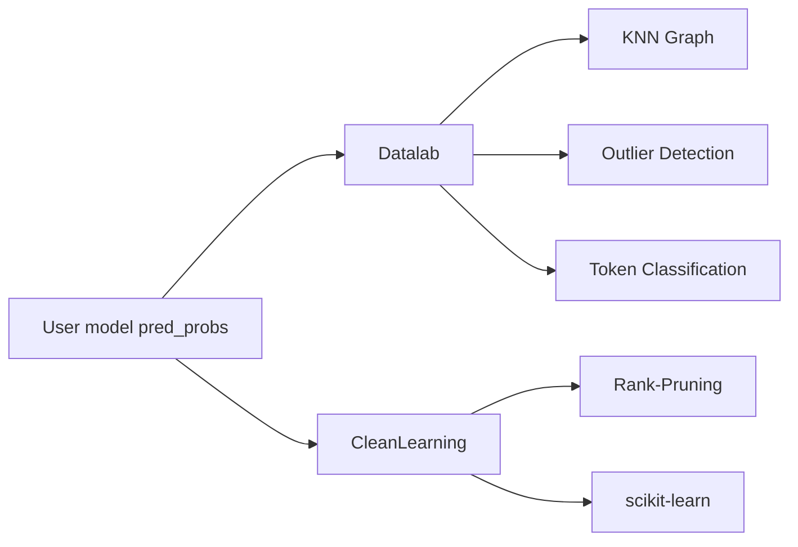

# cleanlab/cleanlab

> Python library that detects label errors, duplicates and outliers in an ML dataset.

## The problem
Wrong labels and outlier data degrade models, and spotting them by hand across thousands of examples is impossible.

## What it actually does
`Datalab.find_issues()` uses embeddings and `pred_probs` from your own model to list label errors, outliers and duplicates, then `report()`.
`CleanLearning` wraps any scikit-learn-compatible classifier to train a noise-robust version.
Published confident learning; dedicated tasks: multi-label, token classification, regression, segmentation, object detection, multi-annotator, active learning.
Agnostic to the model and data type (text, image, audio, tabular).

## How it is wired

## Trying it
No shell command in the README: installation via uv, pip or conda is deferred to the docs; a Python example `cleanlab.Datalab(...)` is provided.

## Cost and gotchas
Free, Apache-2.0, Python 3.10+; diagnosis quality depends on out-of-sample predicted probabilities (cross-validation).

## What it is not
Not an annotation tool: it flags, you fix.
Not the commercial Cleanlab Studio platform.

## Alternatives
No alternative named in the README.

## For you
Adopt: a Datalab audit before any training costs a few lines and often finds gains without touching the model.
