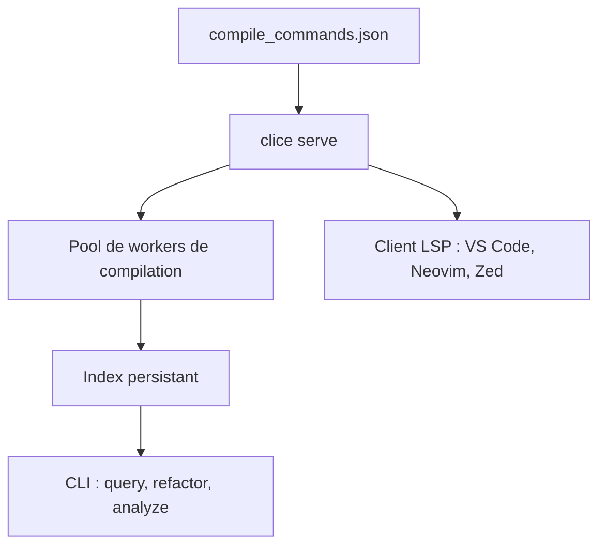

# clice-io/clice

> C/C++ language server in modern C++, based on LLVM/Clang, with an analysis CLI.

## The problem
clangd and ccls struggle with C++20 modules, non-self-contained headers and compilation crashes.

## What it actually does
A pool of isolated compilation processes, a shared PCH/PCM cache, support for named C++20 modules, compilation contexts for headers. A CLI (`index`, `lint`, `format`, `query`, `refactor`, `modularize`) reuses the index.

## How it is wired
Simplified diagram based on the sheet, no diagram provided.


## Trying it
```bash
cmake -B build -DCMAKE_EXPORT_COMPILE_COMMANDS=ON
```
```lua
vim.lsp.enable('clice')
```

## Cost and gotchas
Free (Apache-2.0). A `compile_commands.json` is required. Version 1.0 has just been released: expect bugs.

## What it is not
Not a compiler or an IDE: an LSP server to plug into an existing editor.

## Alternatives
clangd and ccls, cited in the README as the servers whose limits clice fixes.

## For you
Ignore: useful only if you write C++ daily, which falls outside the data / AI / MLOps scope.
