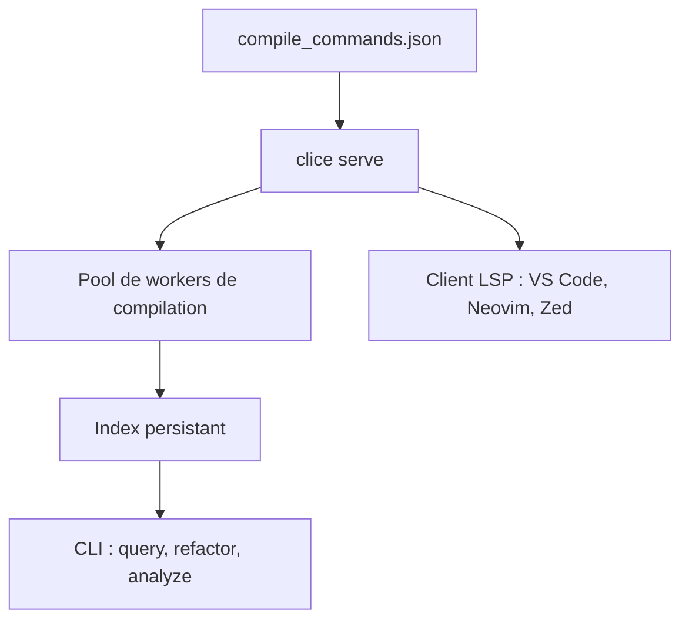

# clice-io/clice

> Serveur de langage C/C++ en C++ moderne, basé sur LLVM/Clang, avec une CLI d'analyse.

## Le problème
clangd et ccls peinent sur les modules C++20, les en-têtes non autonomes et les plantages de compilation.

## Ce que ça fait vraiment
Un pool de processus de compilation isolés, un cache partagé de PCH/PCM, le support des modules C++20 nommés, des contextes de compilation pour les en-têtes. Une CLI (`index`, `lint`, `format`, `query`, `refactor`, `modularize`) réutilise l'index.

## Comment c'est branché
Schéma simplifié d'après la fiche, sans diagramme fourni.


## Essayer
```bash
cmake -B build -DCMAKE_EXPORT_COMPILE_COMMANDS=ON
```
```lua
vim.lsp.enable('clice')
```

## Coût et pièges
Gratuit (Apache-2.0). Il faut un `compile_commands.json`. La version 1.0 vient de sortir : des bogues sont attendus.

## Ce que ce n'est pas
Pas un compilateur ni un IDE : un serveur LSP à brancher à un éditeur existant.

## Alternatives
clangd et ccls, cités dans le README comme les serveurs dont clice corrige les limites.

## Pour toi
À ignorer : utile seulement si tu écris du C++ au quotidien, ce qui sort du périmètre data / IA / MLOps.

