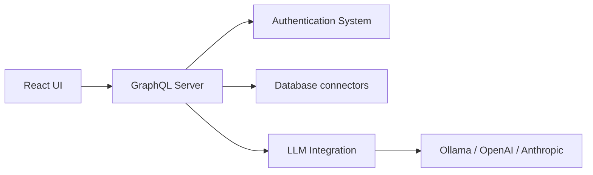

# clidey/whodb

> Lightweight, self-hosted workspace to explore, edit and query databases.

## The problem
Inspecting an unfamiliar database means installing a heavy client or writing SQL blindly.

## What it actually does
Web interface with an editable grid, a schema graph, a multi-cell query editor, import/export and fake data generation. Optional natural-language chat with Ollama, LM Studio, OpenAI, Anthropic or Gemini. Desktop version, CLI with a terminal interface and an MCP server. Connectors for PostgreSQL, MySQL, SQLite, MongoDB, Redis, ElasticSearch, ClickHouse.

## How it is wired


## Trying it
```bash
docker run --rm -it -p 8080:8080 clidey/whodb
```
Then open http://localhost:8080.

## Cost and gotchas
Free; the AI is optional and an API key is only needed for a hosted provider. Generate and keep `WHODB_ENCRYPTION_KEY` to preserve sessions.

## What it is not
Not a BI or orchestration tool. The chat is not guaranteed to be reliable: check the generated SQL.

## Alternatives
The README names no alternatives.

## For you
Worth adopting to quickly explore development databases: a single `docker run` is enough, Apache-2.0 license, active.
