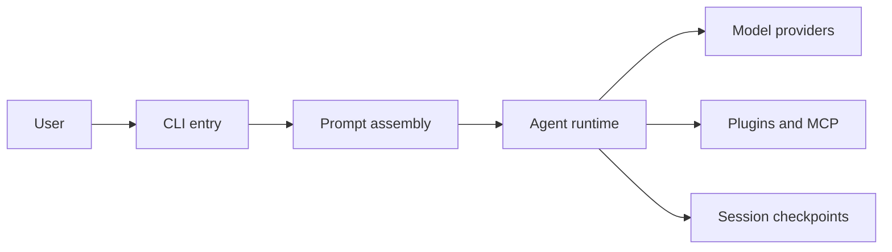

# cline/cline

> Open-source code agent that can be used in the terminal, VS Code, JetBrains, and a desktop application.

## The problem
Delegating multi-file changes to a template requires careful management of each command and each edit.

## What it actually does
Reads the project, edits files (diffs to be validated, checkpoints for rollback), executes shell commands while monitoring their output. Uses "Plan" mode and "Act" mode, with `.clinerules` rules, SDK plugins, MCP servers, multi-agent teams, and cron-scheduled agents. Also supports headless mode for CI. Works with Anthropic, OpenAI, Gemini, OpenRouter, Bedrock, Ollama, etc.

## How it is wired


## Trying it
```bash
npm i -g cline
cline "Run tests and fix any failures"
git diff origin/main | cline "Review these changes for issues"
```

## Cost and gotchas
The model provider is your responsibility (API key or local model). The JetBrains plugin is not open source, according to the README.

## What it is not
Not a template: it's an agent that consumes those provided by the chosen vendor. Default approval is enabled, while auto-approval is optional.

## Alternatives
No alternative is specified in the README file.

## For you
Recommended: An open-source code agent, independent of a vendor, with a headless mode useful in CI/CD; monitor the API usage bill.
