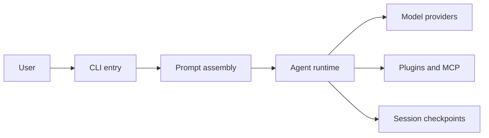

# cline/cline

> Agent de code open source utilisable dans le terminal, VS Code, JetBrains et une appli bureau.

## Le problème
Déléguer des modifications multi-fichiers à un modèle exige de garder la main sur chaque commande et chaque édition.

## Ce que ça fait vraiment
Lit le projet, édite des fichiers (diff à valider, points de contrôle pour annuler), exécute des commandes shell en suivant leur sortie. Mode Plan puis mode Act, règles `.clinerules`, skills, plugins SDK, serveurs MCP, équipes multi-agents, agents planifiés par cron, mode headless pour la CI. Fonctionne avec Anthropic, OpenAI, Gemini, OpenRouter, Bedrock, Ollama, etc.

## Comment c'est branché


## Essayer
```bash
npm i -g cline
cline "Run tests and fix any failures"
git diff origin/main | cline "Review these changes for issues"
```

## Coût et pièges
Le fournisseur de modèle est à ta charge (clé d'API ou modèle local). Le plugin JetBrains n'est pas open source selon le README.

## Ce que ce n'est pas
Pas un modèle : c'est un agent qui consomme ceux du fournisseur choisi. L'approbation de chaque action est la valeur par défaut, l'auto-approbation est optionnelle.

## Alternatives
Aucune alternative nommée dans le README.

## Pour toi
À adopter : agent de code ouvert, indépendant du fournisseur, avec mode headless utile en CI ; surveiller la facture d'API.

