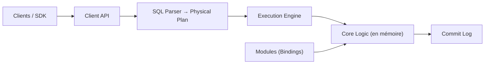

# clockworklabs/SpacetimeDB

> Relational database that hosts application logic and syncs clients in real time.

## The problem
A classic backend stacks a web server, database, cache and pub/sub to keep clients up to date.

## What it actually does
You write a module (Rust, C#, TypeScript or C++) with tables and reducers; it runs inside the database and clients connect to it directly and subscribe to tables. State is in memory, with a commit log on disk (durability, confirmed reads by default since 2.0). The backend of the MMORPG BitCraft runs on it. Optimized for transactional workloads, not analytical ones.

## How it is wired


## Trying it
```bash
curl -sSf https://install.spacetimedb.com | sh
spacetime login
spacetime dev --template chat-react-ts
# ou en local
docker run --rm --pull always -p 3000:3000 clockworklabs/spacetime start
```

## Cost and gotchas
`spacetime dev` publishes to Maincloud (GitHub account, check pricing). A license is present but not identified by GitHub. 942 open issues.

## What it is not
Not made for batch or analytics. Modules run inside the database: permissions must be written carefully.

## Alternatives
No alternative named in the README.

## For you
A curiosity for real-time apps; little room in a classic data pipeline, and the license must be read before any use.
